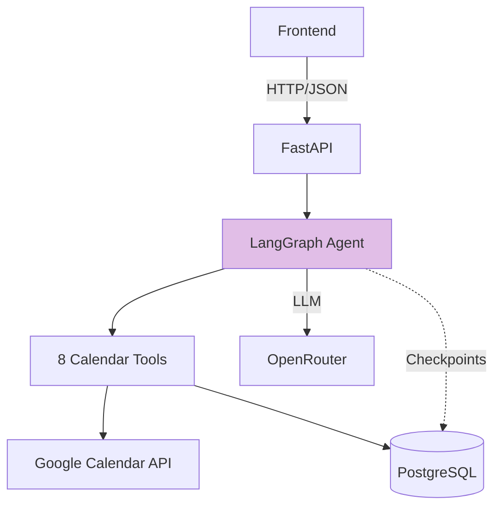
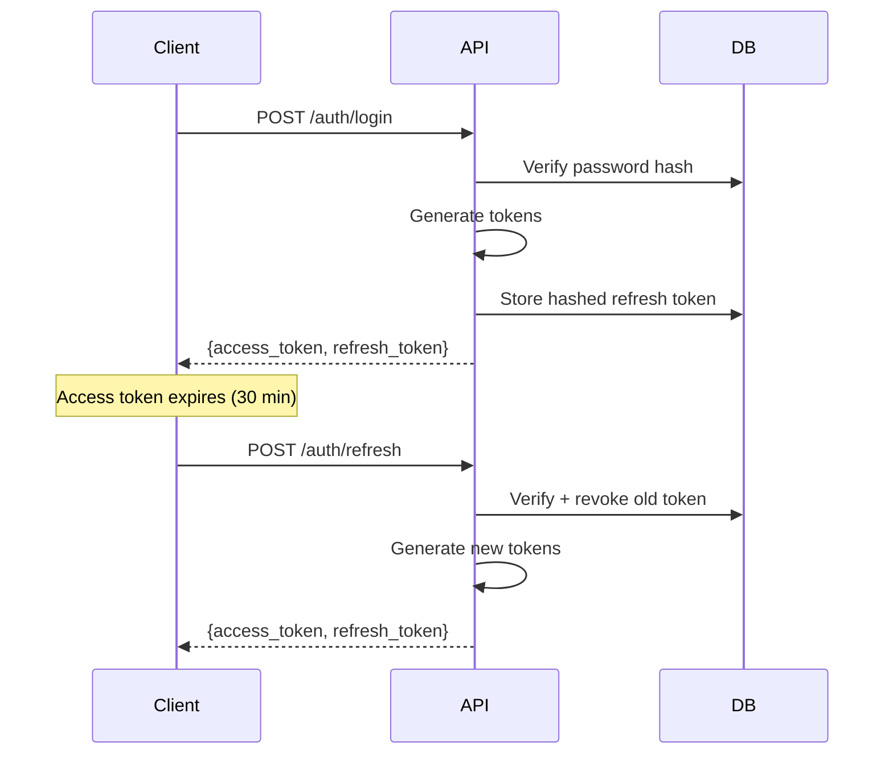
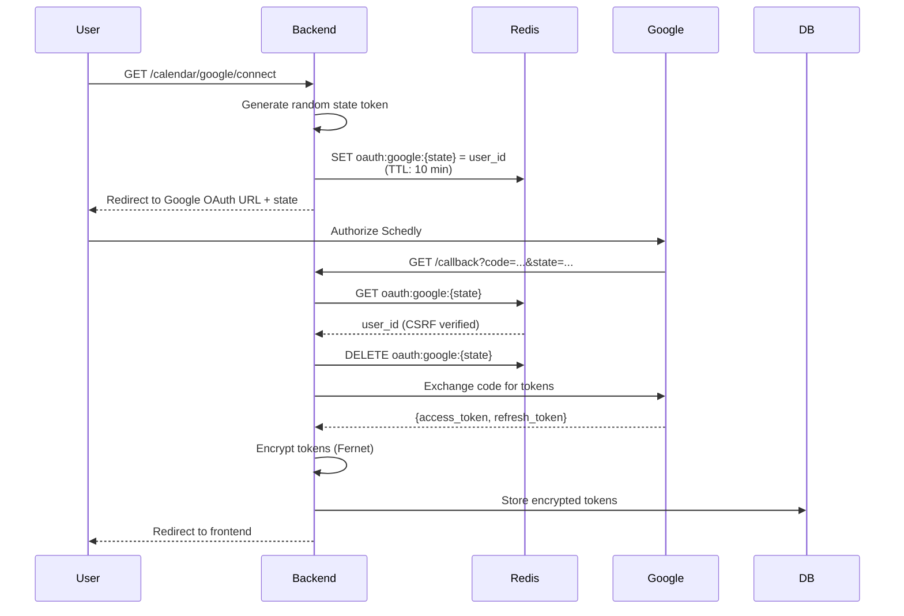
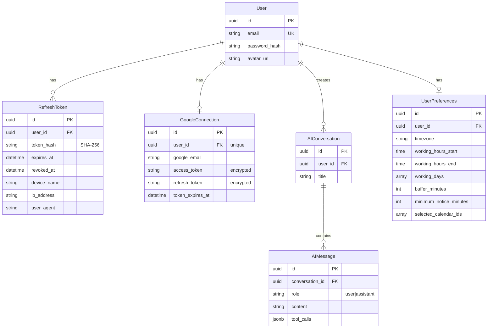

# Schedly Backend

AI-powered calendar assistant backend built with FastAPI and LangGraph. Translates natural language into calendar operations using stateful agent architecture.

## Tech Stack

- **Framework**: FastAPI 0.142 (async Python)
- **AI Agent**: LangGraph 1.2 with OpenRouter LLMs
- **Database**: PostgreSQL (asyncpg) + SQLModel ORM
- **Auth**: JWT + Argon2 password hashing
- **External APIs**: Google Calendar API (OAuth 2.0)
- **Migrations**: Alembic
- **Test**: Pytest

## Architecture



## Running Locally

### Prerequisites
- Python 3.11+
- PostgreSQL 14+ (two databases required)
- Redis 6+ (required for OAuth CSRF protection)

### Setup

```bash
# 1. Navigate to backend
cd backend

# 2. Create virtual environment
python -m venv venv
source venv/bin/activate  # Windows: venv\Scripts\activate

# 3. Install dependencies
pip install -r requirements.txt

# 4. Configure environment
cp .env.example .env
# Edit .env with your credentials (see Environment Variables section)

# 5. Create databases
createdb schedly
createdb schedly_langgraph

# 6. Run migrations
alembic upgrade head

# 7. Start server
uvicorn app.main:app --reload --port 8000
```

API docs: http://localhost:8000/docs (auto-generated Swagger UI)

### Module Structure

```
backend/app/
├── main.py                      # FastAPI app + lifespan
├── api.py                       # Router aggregation
├── core/                        # Configuration, security (JWT/Argon2), and logging
├── database/                    # Database session pooling and Redis cache layer
└── modules/                     # Feature modules
    ├── auth/                    # User authentication and refresh token rotation
    ├── google_calendar/         # Google OAuth, token encryption, and calendar client
    ├── preferences/             # User scheduling preferences and calendar filtering
    └── agent/                   # LangGraph implementation, tools, and endpoints
```

## Authentication

Schedly implements **two-layer authentication**: JWT for API access, OAuth 2.0 for Google Calendar.

### 1. App Authentication (JWT)

**Two-Token System:**



**Token Types:**

| Token | Lifespan | Storage | Purpose |
|-------|----------|---------|---------|
| **Access Token (JWT)** | 30 minutes | Client memory | API authorization (Bearer) |
| **Refresh Token** | 7 days | DB (SHA-256 hashed) | Access token renewal |

**Key Implementation:**
- **Access Token**: JWT with `{sub: user_id, email, exp, iat}` - validated via `get_current_user()` in `auth/dependencies.py`
- **Refresh Token**: SHA-256 hashed before storage - single-use rotation in `auth/service.py:verify_refresh_token()`
- **Password Security**: Argon2id via `passlib` - memory-hard, side-channel resistant (see `core/security.py`)

**Multi-Device Sessions:**
- Each refresh token stores device metadata (IP, User-Agent, device name)
- `auth/service.py:get_user_sessions()` lists active devices
- `auth/service.py:revoke_all_user_tokens()` enables account-wide logout

### 2. Google Calendar Authentication (OAuth 2.0)

**OAuth Flow with Redis State Management:**



**Redis Role in OAuth (CSRF Protection):**

Redis stores temporary OAuth state mappings to prevent CSRF attacks:

1. **State Generation** (`google_calendar/router.py:connect_google_calendar()`):
   - Generate cryptographically secure random token (32 bytes)
   - Store mapping: `oauth:google:{state}` → `user_id` with 10-minute TTL
   - Include state in OAuth authorization URL

2. **State Validation** (`google_calendar/router.py:google_callback()`):
   - Fetch `user_id` from Redis using state from callback
   - Verify state exists (not expired, not tampered)
   - Delete state immediately after consumption (single-use enforcement)
   - Exchange authorization code for tokens

**Security Properties:** Single-use deletion upon validation, 10-minute time-bound TTL preventing replay attacks, user-bound mapping preventing cross-account reuse, and 32-byte URL-safe random tokens providing 256-bit entropy.

**Token Refresh Strategy:**
- Access tokens expire after 1 hour
- Refresh happens synchronously within DB transaction to prevent race conditions
- Failed refresh triggers re-authentication (user must reconnect)

**Database Model:**
- `GoogleConnection` table: `user_id`, `google_email`, `access_token` (encrypted), `refresh_token` (encrypted), `token_expires_at`
- One connection per user (unique constraint on `user_id`)

## LangGraph Agent Design

### Graph Structure

**Stateful conversation graph** (not simple prompt-response loop):


**Implementation:**
- **Graph Definition**: `agent/gragh.py` - compiles StateGraph with chat node + tool node
- **Chat Node**: `_call_model()` - injects user timezone into system prompt, invokes LLM
- **Checkpointing**: `AsyncPostgresSaver` for production (persistent conversations), `MemorySaver` for local dev
- **State**: `agent/state.py:ChatState` - extends `MessagesState` with `user_timezone` field

### Tool Suite

8 LangGraph tools in `agent/tools.py`:

| Tool | Purpose | Key Features |
|------|---------|--------------|
| `list_calendars` | Enumerate accessible calendars | Filters by `minAccessRole=freeBusyReader` |
| `get_events` | Fetch events in time range | Multi-calendar aggregation, preference filtering |
| `check_free` | Batch availability check | Single freebusy query, interval merging |
| `find_slots` | Open meeting slot discovery | Working hours + buffer + minimum notice |
| `create_event` | Insert calendar event | Timezone-aware, attendee invites |
| `update_event` | Patch event fields | Partial updates, fetches current state |
| `delete_event` | Remove event | Confirmation-gated deletion |
| `get_event` | Single event retrieval | By ID + calendar ID |

**Tool Design Pattern:**
- All tools extract `user_id`, `calendar_connection`, and `db_session` from `RunnableConfig` via `agent/services.py:get_google_client_from_config()`
- Return `{"success": bool, "error": str | None, ...}` for consistent error handling
- All failures logged, never thrown (agent continues conversation)

## Google Calendar Integration

### Service Layer Design

**Philosophy**: Business logic in `google_calendar/service.py` is decoupled from OAuth. All functions accept a pre-authenticated `Resource` client.

### OAuth Token Management

**Challenge**: Concurrent requests can trigger simultaneous token refreshes, invalidating one refresh token.

**Solution** (in `google_calendar/client.py:get_google_calendar_client()`):
- Refresh is synchronous within DB transaction
- SQLModel session prevents concurrent updates to same `GoogleConnection` row
- Decryption, expiry check, refresh if needed, re-encryption, DB commit

**Flow**:
1. Fetch `GoogleConnection` for user (row lock acquired)
2. Decrypt tokens with Fernet
3. Check if access token expired
4. If expired: call `credentials.refresh(Request())`
5. Update DB with new access token + expiry
6. Commit transaction (releases lock)
7. Build Google Calendar API client

## Database Schema




## Key Engineering Decisions

### 1. Async Postgres Connection Pooling

**Problem**: SQLAlchemy + asyncpg can have stale connection issues under high concurrency.

**Solution** (in `database/session.py`):
```python
engine = create_async_engine(
    settings.database_url,
    pool_pre_ping=True,              # Verify connection before use
    connect_args={
        "statement_cache_size": 0    # Disable asyncpg prepared stmt cache
    },
    execution_options={
        "compiled_cache": None        # Disable SQLAlchemy compiled cache
    }
)
```

**Trade-off**: Slight performance hit for reliability. `pool_pre_ping` recycles dead connections automatically.

### 2. LangGraph Checkpointing Strategy

**Implementation** (in `agent/gragh.py:_build_checkpointer()`):
- **Production**: `AsyncPostgresSaver` with dedicated connection pool (conversation persistence across restarts)
- **Local Dev**: `MemorySaver` fallback if `LANGGRAPH_DB_URL` unset (conversations don't survive restarts)

**Why Postgres Checkpointing**:
- Conversations survive across server restarts
- Multi-instance deployment support (load balancing)
- Full conversation history queryable

### 3. Timezone Handling

**Strategy**: All datetime operations use timezone-aware objects via `zoneinfo.ZoneInfo` (Python 3.9+ stdlib).

**Implementation**:
- **Storage**: Always UTC in database
- **Conversion**: At presentation layer using user's timezone from preferences
- **Agent Context**: User timezone injected into system prompt on every turn (see `agent/gragh.py:_call_model()`)

**Pitfalls Avoided**:
- Naive datetime arithmetic (breaks DST transitions)
- `pytz` (deprecated, use `zoneinfo`)
- Use `datetime.now(tz)` not `datetime.now().replace(tzinfo=tz)`

**Key Functions**:
- `google_calendar/service.py:_get_zoneinfo()` - safely obtain tzinfo object
- `google_calendar/service.py:_localize_dt()` - attach or convert timezone
- `google_calendar/service.py:_to_rfc3339()` - format for Google Calendar API

### 4. Redis for OAuth State Management

Redis is required for secure OAuth CSRF state management. Unlike databases (too slow for high-frequency redirects without native TTLs), cookies/JWTs (client-controlled security risks), or in-memory dicts (lost on restart and multi-instance deployments), Redis provides fast, atomic operations, native TTL support, and distributed multi-instance state storage.

### 5. LangGraph vs. Raw LangChain

**Why LangGraph over `AgentExecutor`:**

| Feature | LangGraph | AgentExecutor |
|---------|-----------|---------------|
| **Graph Structure** | Explicit (chat → tools → chat) | Implicit loop |
| **Checkpointing** | First-class Postgres support | Manual implementation |
| **State Inspection** | Full graph state accessible | Black box |
| **Debugging** | Graph visualizations | Print statements |
| **Error Recovery** | Conditional edges | Try-catch |

### 6. Google Calendar Service Trade-offs
- **Multi-Calendar Fetching**: Uses sequential queries rather than parallel requests to avoid thread-safety and SSL issues with `googleapiclient`.
- **Slot Finding**: Utilizes a single freebusy query (O(1)) across the entire date range instead of per-day queries (O(n_days)) for performance and efficiency.

## Environment Variables

Copy `.env.example` to `.env` and configure your credentials:

```bash
cp .env.example .env
```

For detailed explanations of required and optional configuration variables (such as database URLs, API keys, and model selection), see `.env.example`.

## Testing the Agent

**Example conversation flow:**

```
User: "Am I free tomorrow at 2pm?"
Agent: [calls check_free tool]
Response: "You have a meeting at 2pm tomorrow with John (Team Standup)"

User: "Find me a 30-minute slot this week for coffee"
Agent: [calls find_slots tool with duration_minutes=30]
Response: "I found 3 slots: Tuesday 10:30am, Wednesday 2pm, Friday 3pm"

User: "Book Tuesday with alice@example.com"
Agent: [calls create_event tool]
Response: "Done! I've sent Alice a calendar invite for Tuesday 10:30am"
```

**Agent Decision Process:**
1. Parses natural language for temporal expressions ("tomorrow", "this week")
2. Decides which tools to call based on intent
3. Respects user preferences (timezone, working hours)
4. Handles multi-step operations (find slots then create event)

## Testing Suite

Comprehensive unit and integration test suite built with `pytest` and `pytest-asyncio`.

- **Test Score**: **37 / 37 tests passing** (100% success rate across auth, security, users, preferences, agent tools, and Google Calendar integrations).
- **Reference folder**: backend/test

### Test Architecture
- **In-Memory Async DB**: Uses SQLite async engine (`sqlite+aiosqlite:///:memory:`) with `StaticPool` for isolated, high-speed database tests.
- **Fixtures (`tests/conftest.py`)**: Automatic database table creation/teardown per test, async client fixtures (`AsyncClient`), and authenticated user test factories.
- **Mocking**: External services (Redis, Google Calendar API, LangGraph LLM calls) are mocked for hermetic unit testing.

### Running Tests
```bash
# Run all backend tests
cd ./backend
pytest -v

# Run with coverage
pytest --cov=app -v
```

## Dependencies

- **Core Framework**: FastAPI, Uvicorn, SQLModel, asyncpg, Alembic
- **AI/LLM Stack**: LangChain, LangGraph, langgraph-checkpoint-postgres, langchain-openai
- **Security**: python-jose, passlib, argon2-cffi, cryptography
- **Google APIs**: google-api-python-client, google-auth, google-auth-oauthlib
- **Production**: Redis, pydantic-settings, python-dotenv

---

**Built with FastAPI, LangGraph, and Google Calendar APIs**
